# 알람 구조

> 알람 정책이 어떻게 만들어지고, 어디서 평가되고, 어떤 길로 알림이 나가는지 설명한다.
> 그림의 정본은 `docs/image/architecture/alert-architecture.mmd` 다. 큐 설계의 배경은 [RABBITMQ_GUIDE.md](../guide/RABBITMQ_GUIDE.md) 에 있다.

## 목적

manager 는 알람 조건을 직접 평가하지 않는다. 🔑 정책을 Grafana 알람 규칙으로 바꿔 등록하고, 평가는 Grafana 가 하며, 결과를 RabbitMQ 로 받아 채널로 보낸다. 이 분업을 한 장으로 잡는다.

## 1. 정책 등록

| 단계 | 하는 일 | 근거 |
|---|---|---|
| 정책 저장 | Alerts 화면에서 정책·대상·채널을 저장한다. 정책을 만드는 것만으로는 Grafana 규칙이 생기지 않는다 | `TriggerController.java:40-150`, `TriggerService.java:76-79` |
| 대상 추가 | 대상(infra 또는 node) 하나마다 Grafana 규칙 하나를 provisioning API 로 등록한다. 등록 직후 시험 실행하고 실패하면 지운다 | `TriggerService.java:55`, `GrafanaAlertManager.java:78-134` |
| 정책 수정 | 규칙을 지우고 다시 만든다 | `TriggerService.java:109-113` |
| 대상·정책 삭제 | 해당 규칙을 지운다 | `TriggerService.java:125,205` |

규칙 하나는 Grafana 안에서 세 단계로 평가된다 (`GrafanaAlertRuleFactory.java:72-99`).

| 단계 | 내용 |
|---|---|
| A 조회 | InfluxDB 에 Flux 쿼리. node 대상은 `infra_id` 로도 거른다 (`QueryFactory.java:58-78`) |
| B 축약 | 마지막 값 |
| C 단계 | `($B>crit)+($B>warn)+($B>info)` 로 1~3 단계 |

대상 지표는 CPU·메모리·디스크다. Loki 로그 기반 규칙은 없다.

## 2. 발생과 전달

| 구간 | 내용 | 근거 |
|---|---|---|
| Grafana → RabbitMQ | contact point `o11y` 가 MQTT topic `alert` 로 JSON 을 보낸다 | `config/grafana/run.sh:150` |
| RabbitMQ 안 | `mqtt.topic` → `alert.exchange` (key `alert`) → `alert.queue`. 처리에 실패하면 `alert.dlx` → `alert.dlq` | `RabbitMQConfig.java:98-154`, `application.yaml:42-56` |
| 소비 | `AlertEventConsumer` 가 `alert.queue`·`alert.dlq`·`alert-manual.queue` 를 듣는다 | `AlertEventConsumer.java:67,101,135` |
| 정책 찾기 | Grafana 라벨 `ruleGroup` (정책 이름) 으로 정책을 찾는다 | `AlertEventConsumer.java:88` |
| 이력 | 발생(firing)은 `trigger_history`, 채널별 발송 결과는 `noti_history` 에 쓴다 | `TriggerService.java:210-219`, `NotiService.java:97-99` |
| 테스트 발송 | 화면의 테스트 버튼은 Grafana 를 거치지 않고 `alert-manual.exchange` 로 바로 넣는다 | `NotiController.java:67-69`, `DirectAlertPublisher.java:28-30` |

## 3. 채널

정책마다 고른 채널과 수신자로 보낸다 (`trigger_policy_noti_channel`, `NotiService.java:86-94`).

| 채널 | 방식 | 근거 |
|---|---|---|
| Email | SMTP, HTML 템플릿 | `MailNotifier.java:39-54` |
| SMS | NCP SENS | `SmsNotifier.java:44-60` |
| Kakao 알림톡 | NCP, 템플릿 조회 후 발송 | `KakaoNotifier.java:44-60` |
| Slack | Bot token POST | `SlackNotifier.java` |
| Teams | Workflows webhook, Adaptive Card | `TeamsNotifier.java:46-68` |
| Discord | webhook | `DiscordNotifier.java:45-63` |

채널 목록은 시작할 때 `noti_channel` 테이블에 채워진다 (`ApplicationInitializer.java:40-43`).

## 4. 대상

| 범위 | 내용 |
|---|---|
| `infra` | 그 infra 의 모든 노드 |
| `node` | 노드 하나. `infraId` 로 infra 를 함께 지정한다. `infraId` 가 없는 옛 대상은 모든 infra 의 같은 이름 노드에 걸린다 (`TriggerVM.java:30-36`) |
| K8s | 화면에서 클러스터를 infra 처럼, 클러스터 노드를 node 처럼 고른다. 클러스터에서 사라진 노드는 목록에서 뺀다 (`front/src/pages/AlertManager.jsx`) |

## 5. 남은 것

- ⚠️ 해소(resolved) 알림은 저장하지 않는다. firing 만 이력에 남는다 (`AlertEvent.java:53`).
- `trigger_history` 를 보여 주는 화면이 없다. Alerts 화면의 이력 탭은 `noti_history` 만 읽는다 (`front/src/api/trigger.js:66` 의 `getTriggerHistory` 는 호출하는 곳이 없다).
- 삭제된 VM 을 정리하는 `StaleTargetReconciler` 는 노드와 K8s 작업 기록만 지운다. 그 VM 의 알람 대상과 Grafana 규칙은 남는다 (`StaleTargetReconciler.java:48-50`).
