# GPU 수집

> VM 의 NVIDIA GPU 지표가 어떻게 수집되어 InfluxDB 에 쌓이고, 어떤 API 로 조회되는지 설명한다.
> 그림의 정본은 `docs/image/architecture/gpu-collection.mmd` 다.

## 목적

GPU 수집은 별도 exporter 없이 telegraf 하나로 한다. 🔑 nvidia-smi 로 대부분을 얻고, MIG 게스트에서 nvidia-smi 가 비워 두는 사용률만 NVML GPM 으로 채운다. 결과는 measurement `dcgm` 한 곳에 모인다.

## 1. 켜는 방법

GPU 를 자동으로 감지하지 않는다. 노드를 등록할 때 `gpu=true` 를 주면 manager 가 telegraf 설정에 GPU 블록 4개를 이 순서로 붙인다 (`TelegrafConfigFacadeService.java:249-256`).

| 순서 | 블록 | 하는 일 |
|---|---|---|
| 1 | `telegraf_inputs_nvidia_smi` | `nvidia-smi -q -x` 로 GPU 정보 수집. 프로세스별 포인트는 버린다 |
| 2 | `telegraf_processors_nvidia_smi_to_dcgm` | 필드 이름을 바꿔 measurement `dcgm` 으로 만든다 |
| 3 | `telegraf_inputs_nvidia_gpm` | NVML GPM 으로 `sm_util` 수집 (1초 샘플, 30초 주기) |
| 4 | `telegraf_processors_gpm_to_dcgm` | MIG 게스트일 때만 `sm_util` 을 `gpu_util` 로 넣는다 |

블록은 `java/mc-o11y-manager/src/main/resources/` 에 있다. 순서가 중요하다. 4번은 2번이 만든 `dcgm` 포인트를 먼저 봐야 같은 GPU 의 태그를 알 수 있다.

노드에는 GPU 용으로 따로 설치하는 것이 없다. nvidia-smi 와 NVML 은 NVIDIA 드라이버에 들어 있고, telegraf 는 GPU 파서를 고친 `cmp-telegraf` 빌드를 쓴다 (`agent-install-files/*/telegraf/bin/`).

## 2. 환경별 동작

| 환경 | nvidia-smi `gpu_util` | GPM | 결과 |
|---|---|---|---|
| passthrough | 있음 | 버림 | nvidia-smi 값 |
| vGPU (time-sliced) | 있음 | 버림 | nvidia-smi 값 |
| MIG 게스트 | N/A | `sm_util` 사용 | GPM 값이 `gpu_util` 이 된다 |

구별은 설정이 아니라 실행 중에 "nvidia-smi 가 `gpu_util` 을 줬는가" 로 한다 (`telegraf_processors_gpm_to_dcgm:68-76`). NVML 을 못 읽으면 GPM 은 조용히 아무것도 안 낸다 (`telegraf_inputs_nvidia_gpm:29-30`).

## 3. 저장

| 항목 | 값 |
|---|---|
| measurement | `dcgm` |
| 공통 태그 | `ns_id`, `infra_id`, `node_id` (`telegraf_global`) |
| GPU 태그 | `uuid`, `index`, `name`, `pstate` |
| 주기 | 30초 수집, 60초 전송 (`telegraf_agent`) |

필드 분류 8개: clocks, temperature, power, utilization, errors(ECC·row remap), memory_usage, ecc, remapped_rows (`GpuMetricKeyField.java:33-40`).

수집하지 않는 것: XID 오류, PCIe 처리량, NVLink, 누적 에너지, vGPU 라이선스 (`GpuMetricKeyField.java:20-21`).

## 4. 조회

| API | 하는 일 | 근거 |
|---|---|---|
| `GET /api/o11y/monitoring/gpu/list` | 필드 정의 | `GpuMonitoringController.java:35` |
| `GET /api/o11y/monitoring/gpu/field/check/{ns}/{infra}/{node}` | 필드마다 최근 5분 데이터가 있는지 | `GpuMonitoringFacadeService.java:64-119` |
| `POST /api/o11y/monitoring/gpu/metric/{ns}/{infra}/{node}` | measurement 를 `dcgm` 으로 고정해 조회. 메트릭 캐시를 거친다 | `GpuMonitoringFacadeService.java:122-135` |

## 5. 남은 것

- front 에 GPU 전용 화면이 없다. 노드 상세의 measurement 목록에는 telegraf 설정에서 읽은 `nvidia_smi`·`nvidia_gpm` 이 보이지만, 데이터는 `dcgm` 에 있다.
- K8s 노드는 GPU 를 수집하지 않는다. K8s 노드에서 고를 수 있는 입력은 cpu·mem·disk·diskio·net·system·processes·swap 이다 (`K8sAgentService.java:82-89`).
- 호스트(하이퍼바이저) 쪽 GPU-VM 매핑은 없다. VM 안에서만 수집한다.
