# 모니터링 구조

> 메트릭·로그·트레이스가 수집 대상에서 화면까지 어떤 길로 가는지와, 에이전트가 어떻게 설치되는지 설명한다.
> 그림의 정본은 `docs/image/architecture/*.mmd` 이고 `.svg` 는 거기서 렌더한 것이다. 그림을 고칠 때는 `.mmd` 를 고쳐 다시 렌더한다.

## 목적

이 repo 를 처음 보는 사람이 "데이터가 어디서 와서 어디에 쌓이고, 화면은 무엇을 조회하는가" 를 한 장으로 잡는다.

## 1. 수집과 조회

| 신호 | 수집 주체 | 저장소 | 근거 |
|---|---|---|---|
| 메트릭 | VM 의 `cmp-telegraf`, K8s 노드의 host `telegraf` | InfluxDB (2대 중 하나) | `java/mc-o11y-manager/src/main/resources/telegraf_outputs_influxdb` |
| 로그 | VM 의 fluent-bit (podman), K8s 노드의 fluent-bit (host 패키지) | Loki `:3100` | `java/mc-o11y-manager/src/main/resources/fluent-bit.conf:53-57` |
| 트레이스 | beyla eBPF (Linux), OTel Java agent (Windows) | Tempo OTLP gRPC `:4317` | `java/mc-o11y-manager/src/main/resources/beyla_template.yaml:25-35` |
| 스택 자체 로그 | `mc-observability-log-collector` (manager·insight 로그 파일) | Loki | `config/log-collector/fluent-bit.conf:11-46` |
| CSP 지표 | 클라우드가 직접 수집, CB-Spider 모니터링 API 로 조회 | 저장하지 않음 | `SpiderClient.java:17-44` |

조회는 모두 manager 를 거친다. front 는 nginx 가 `/api/o11y` 를 manager 로, `/tumblebug`·`/spider` 를 각 서비스로 넘긴다 (`front/nginx.conf`).

| manager 조회 API | 대상 | 근거 |
|---|---|---|
| `/api/o11y/monitoring/influxdb/metric/{ns}/{infra}[/{node}]` | InfluxDB (InfluxQL) | `InfluxDBController.java:30,82,96` |
| `/api/o11y/log` | Loki `query_range` | `LogController.java:16`, `LokiFeignClient.java:12-43` |
| `/api/o11y/trace` | Tempo search · trace | `TraceController.java:15`, `TempoFeignClient.java:19-52` |
| `/api/o11y/monitoring/csp/node`, `/csp/cluster` | CB-Spider 모니터링 API | `CspMonitoringController.java:34,53,92` |

메트릭 조회 앞에는 manager 메모리 캐시가 있다. 동작은 [cache_architecture.md](cache_architecture.md) 에 있다.

### Insight 쪽

| 구성 | 하는 일 | 근거 |
|---|---|---|
| insight | manager 를 통해 메트릭을 읽어 이상탐지·예측을 하고, 결과는 InfluxDB `insight` DB 에 직접 쓴다 | `python/insight/app/api/anomaly/utils/utils.py:38-63`, `python/insight/config/config.yaml:8-17` |
| insight-scheduler (Airflow) | 이상탐지를 주기 실행하고, Tempo 에서 HTTP 5xx 를 찾아 RCA 를 건다. 다운샘플링도 여기서 한다 | `python/scheduler/airflow-home/dags/anomaly_detection.py:112-120`, `rca_schedule.py:162-204` |
| MCP servers | RCA 가 LLM 도구로 Grafana·MariaDB·InfluxDB 를 조회하는 통로 | `python/insight/config/config.yaml:113-128` |

## 2. 에이전트 설치

| 대상 | 경로 | 설치되는 것 | 근거 |
|---|---|---|---|
| VM (Linux) | manager → Semaphore `install-agent` 템플릿 → Ansible → SSH | telegraf (systemd), fluent-bit (podman), beyla | `SemaphoreDomainService.java:70-171`, `config/mc-observability-infra/ansible/playbooks/install-agent/playbook.yaml:19-46` |
| VM (Windows) | 같은 경로, WinRM | telegraf, fluent-bit, OTel Java agent | `install-agent/playbook.yaml:34-51` |
| K8s node | manager → kubeconfig 로 K8s API → 노드마다 특권 Job (`hostPID`, `nsenter -t 1`) | host telegraf, host fluent-bit (둘 다 systemd) | `K8sAgentService.java:1046-1100` |

- SSH 키와 kubeconfig 는 CB-Tumblebug 에서 받는다. kubeconfig 가 exec plugin 방식이면 Tumblebug 의 `/token` 으로 토큰을 받아 쓴다 (`K8sAgentService.java:252-300`).
- 에이전트가 쓸 InfluxDB 는 `InfluxDbServiceImpl.resolveInfluxDb` 가 아래 순서로 고른다 (`InfluxDbServiceImpl.java:615-668`).

| 순서 | 규칙 |
|---|---|
| 1 | 그 (ns_id, infra_id) 태그를 이미 가진 서버 |
| 2 | 없으면 카디널리티가 가장 낮은 서버 |
| 3 | 그것도 못 정하면 접속되는 첫 서버 |

- Loki·Tempo 주소는 고른 InfluxDB 의 호스트를 따른다. VM 이 같은 호스트의 스택으로 보내게 하기 위해서다 (`FluentBitConfigFacadeService.java:68-87`, `BeylaConfigFacadeService.java:76-93`).
- VM 에 같은 시각에 두 에이전트를 설치해도 된다. 공통 파일(podman 등)은 임시 폴더에 풀어 파일마다 rename 으로 바꿔 넣으므로, 다른 설치가 podman 을 실행하는 중에도 깨지지 않는다 (`agent-install-files/*/cmp-agent_install_common`).

## 3. 남은 것

- K8s 노드 로그 에이전트의 `running` 은 프로세스 상태가 아니라 "최근 Loki 에 그 노드 로그가 있는가" 다 (`K8sAgentService.java:561-600`). 새 로그 줄이 없는 조용한 노드는 정상이어도 `running:false` 로 보인다.
- EKS Amazon Linux 2023 노드에는 `/var/log/messages`·`/var/log/syslog` 가 없다. K8s 노드 로그는 컨테이너 로그만 모인다.
